<a id="top"></a>

# Eyongtarh Besong | Portfolio

A modern, responsive and accessible portfolio website showcasing my skills, experience, education and projects as a **Full Stack Software Developer**. Built with **React**, **Vite** and **Framer Motion**, it focuses on performance, accessibility, security and a clean user experience, with a glassmorphism inspired design.

[](https://react.dev)
[](https://vite.dev)
[](#tech-stack)
[](#automated-tests)
[](LICENSE)


[](https://eyongtarh.com)

<p align="center">
  <a href="https://eyongtarh.com">
    
  </a>
</p>

<p align="center">
  <strong>📱 Scan to visit my portfolio</strong>
</p>

---

**Live website: [eyongtarh.com](https://eyongtarh.com/)**

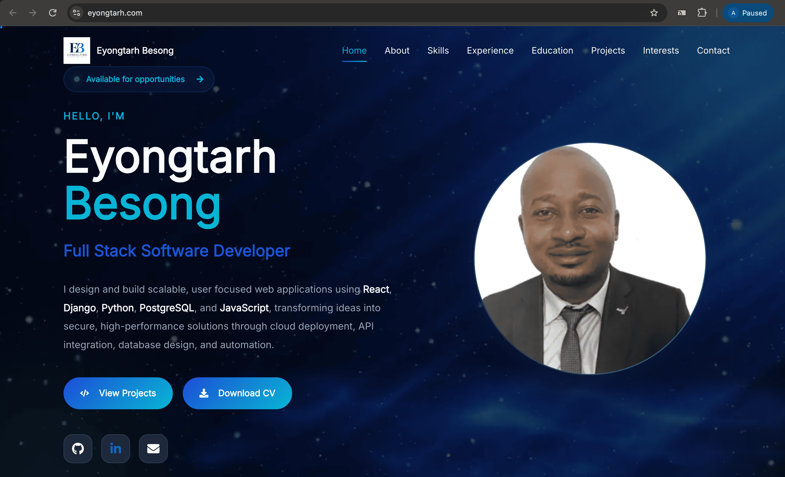

---

## Table of Contents

- [Features](#features)
- [Website Sections](#website-sections)
- [Installation](#installation)
- [Environment Variables](#environment-variables)
- [Available Scripts](#available-scripts)
- [Tech Stack](#tech-stack)
- [Project Structure](#project-structure)
- [Featured Projects](#featured-projects)
- [Wireframes](#wireframes)
- [Testing](#testing)
- [Security and Privacy](#security-and-privacy)
- [Deployment](#deployment)
- [Author](#author)
- [Contact](#contact)
- [Future Enhancements](#future-enhancements)
- [Credits](#credits)
- [Support](#support)
- [License](#license)

---

## Features

### User Experience

- Fully responsive design for desktop, tablet and mobile
- Glassmorphism inspired interface with animated gradient borders
- Animated hero section with background video, playing only after the loading screen fades
- Smooth scrolling navigation with active section highlighting, including lazy loaded sections
- Accessible mobile menu that closes with Escape, an outside click or a switch to desktop width
- Project showcase with category filtering and a pointer tilt effect
- Downloadable CV
- Contact form powered by EmailJS, with validation and spam protection
- Cookie consent banner, so analytics only load after a visitor agrees
- Custom 404, error, loading error and maintenance pages

### Accessibility

- Semantic HTML with a single `main` landmark and a logical heading outline
- "Skip to content" link for keyboard users
- Visible focus outlines on every interactive element
- Form errors announced to screen readers and linked to their fields
- Colour contrast meeting WCAG AA for text and 3:1 for icons, checked automatically by tests
- Respects the "reduce motion" setting: animations, the video and the cursor glow switch off

### Architecture and Code Quality

- Component based React architecture with reusable building blocks
- Shared card, heading and button styles defined once in `globals.css`
- Single sources of truth for contact details, navigation and social links (`src/data/site.js`)
- Experience dates stored as data, formatted in British English and sorted automatically
- Summary statistics derived from the experience data, so they never go out of date
- Error boundaries at page and section level, so one failure never blanks the whole site
- Environment variables read in one place (`src/config/env.js`)
- ESLint with React's latest hook rules, and Jest with 119 automated tests

### Supporting Components

- **LoadingScreen**: waits for the page and fonts, shows for at least 0.6 seconds and never longer than 4
- **Reveal**: fades content in on scroll without blocking CSS hover effects
- **SocialLinks**: one shared list of profile links used across the site
- **ConsentBanner**: GDPR compliant analytics consent
- **AnimatedBackground**, **CursorGlow** and **ScrollProgress**: decorative effects tuned for performance
- **ErrorBoundary** and **SectionError**: graceful recovery from errors

### Data Layer

Project information combines two sources:

- `projects.js`: titles, descriptions, images, categories, live demos, technologies and display order
- `github-repos.json`: repository links and metadata, refreshed from the GitHub API before every build

The GitHub data is trimmed to the fields the site uses, from 122 KB to under 1 KB, and visitors never wait for a GitHub request. A project only shows a "Source code" button when its repository is public.

### Custom Hooks

- **usePageReady**: reports when the page and fonts have loaded, for the loading screen
- **useMediaQuery**: subscribes to a CSS media query, such as pointer type or reduced motion
- **useDocumentMeta**: sets the page title and a `noindex` tag on error pages

### Performance Optimisations

- Lazy loaded Projects and Contact sections with React Suspense and accessible loading skeletons
- Code splitting, with shared code cached once and reused by the 404 page
- Pointer and scroll effects updated once per frame without React re-renders
- Scroll progress driven by a CSS scroll timeline where the browser supports it
- Variable Inter font: one file covering every weight
- Preloaded hero portrait and explicit image sizes to prevent layout shift
- Optional Cloudinary delivery for responsive WebP and AVIF project images
- Automatic recovery when a deployment replaces files a visitor still needs

### Repository Standards

- MIT Licence
- ESLint and Jest configuration
- EditorConfig support
- Node.js version pinned in `.nvmrc` and `package.json`
- `.env.example` documenting every environment variable
- SEO configuration with structured data, Open Graph tags and a generated sitemap

<p align="right">(<a href="#top">Back to top ↑</a>)</p>

---

## Website Sections

### Home

Introduces visitors with an animated hero section featuring a background video, social links and call to action buttons.


### About

An overview of my background, professional experience and approach to software development.

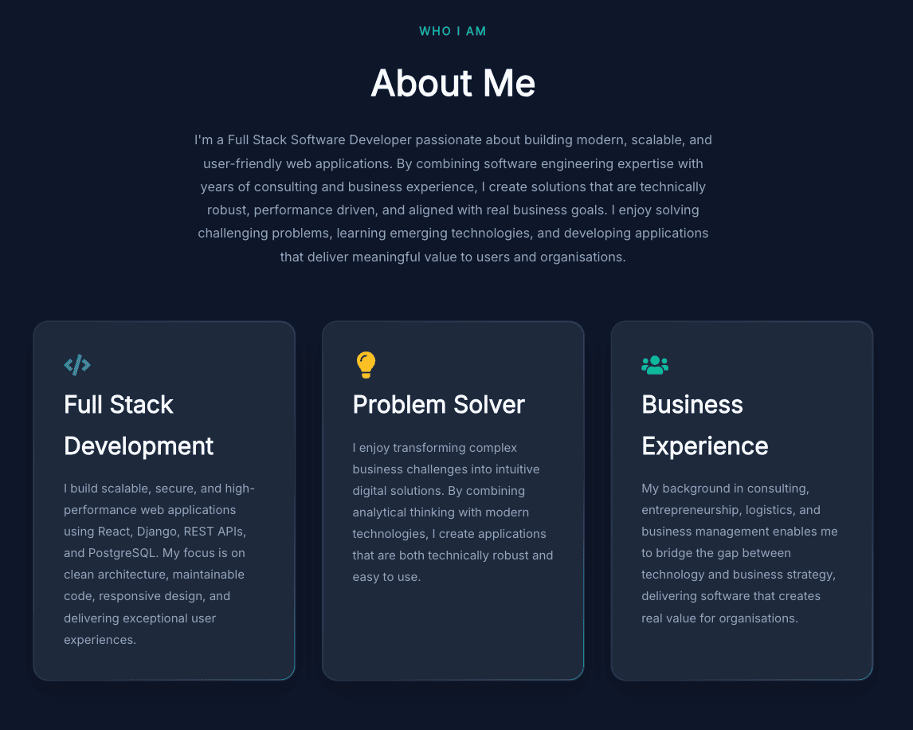

### Skills and Technologies

The programming languages, frameworks, tools and technologies I use, organised into categories.

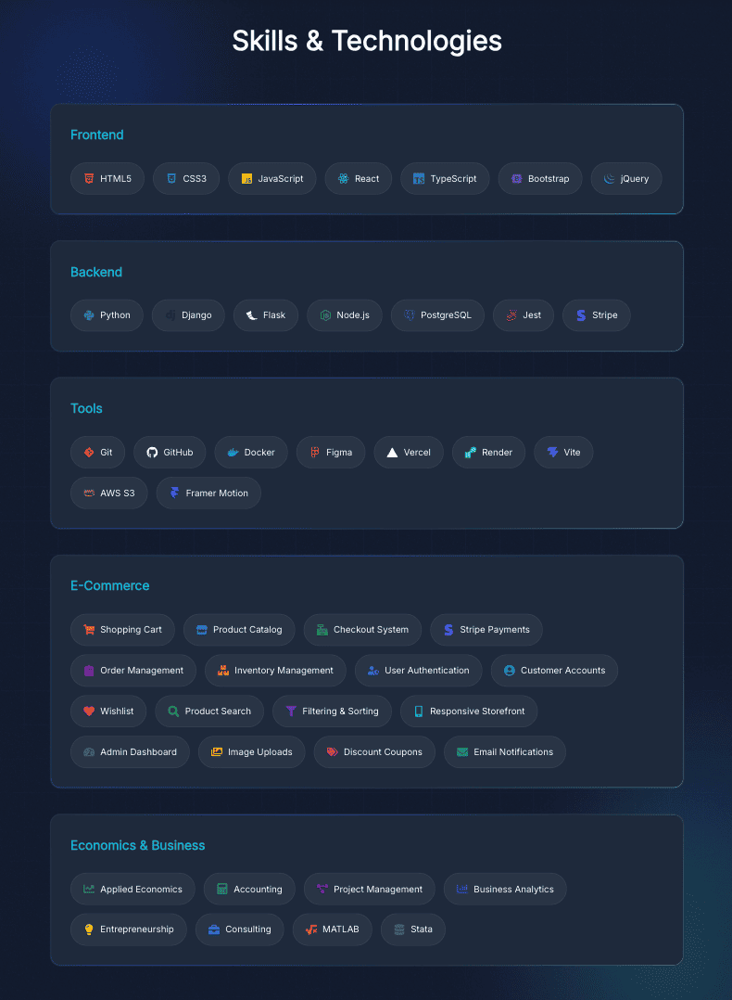

### Professional Experience

My professional journey in a timeline, with summary statistics calculated from the timeline itself.

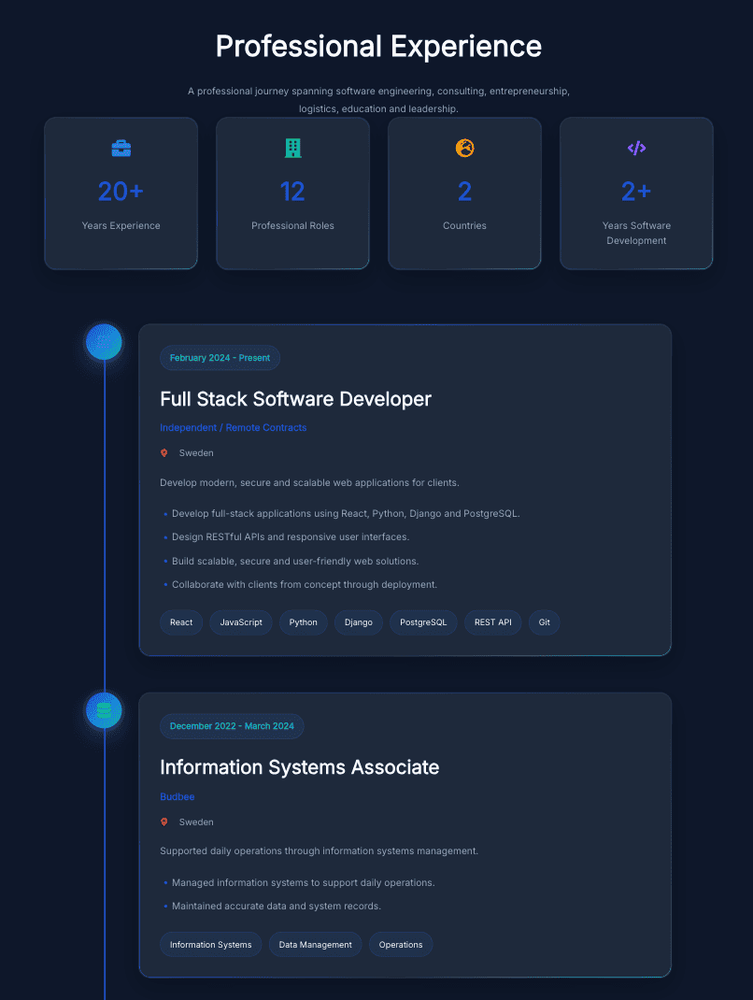

### Education

My academic qualifications and continuous learning.

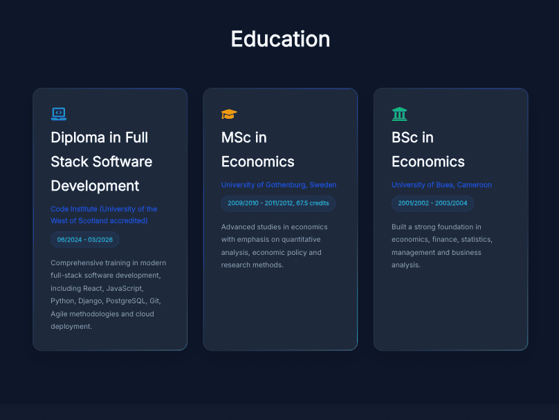

### Featured Projects

Selected software development projects with live demos, source code, technologies and highlights.


### Interests

Personal interests that inspire creativity, continuous learning and problem solving.

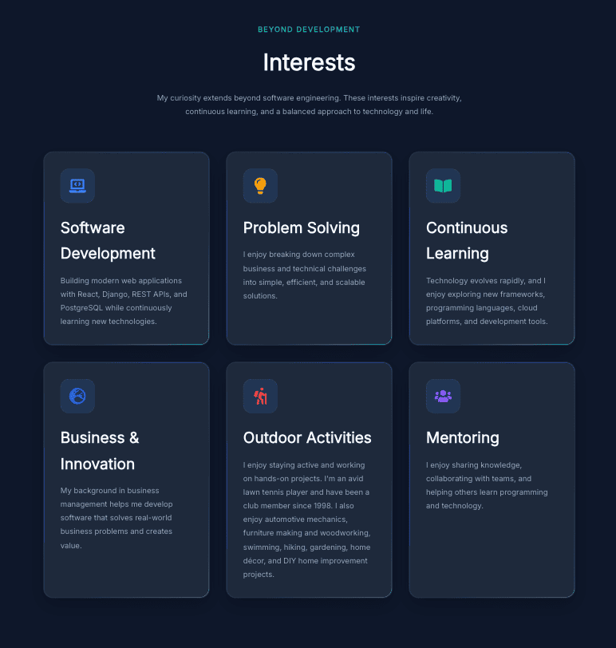

### Contact

Several ways to get in touch, including a contact form, email, phone and professional profiles.

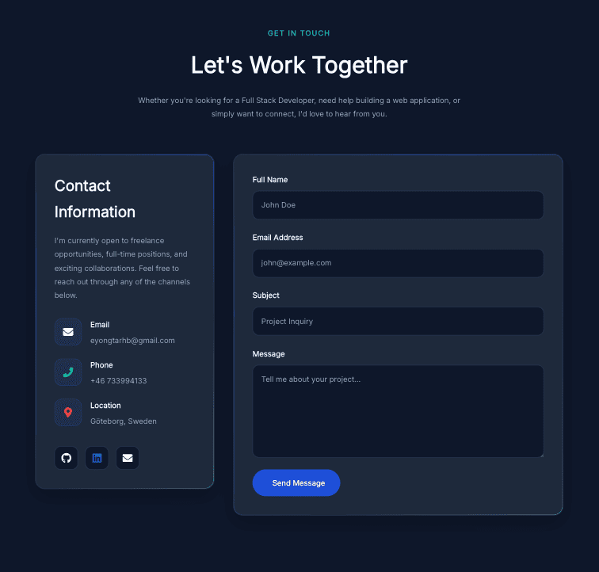

### Footer

Quick navigation links, social profiles, the downloadable CV, cookie settings and copyright information.

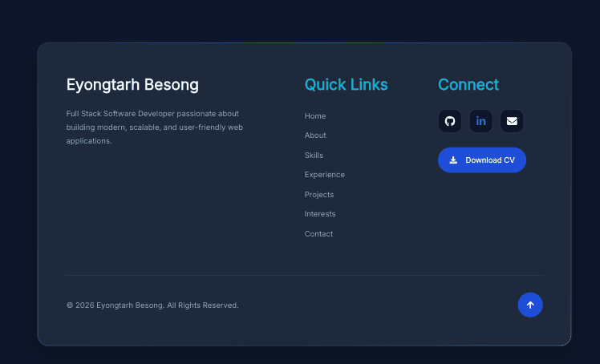

<p align="right">(<a href="#top">Back to top ↑</a>)</p>

---

## Installation

Requires **Node.js 22**. With [nvm](https://github.com/nvm-sh/nvm), run `nvm use` in the project folder to switch automatically.

Clone the repository:

```bash
git clone https://github.com/Eyongtarh/Eyongtarh-portfolio.git
```

Go into the project:

```bash
cd Eyongtarh-portfolio
```

Install the exact dependency versions from the lock file:

```bash
npm ci
```

Create your environment file and fill in your keys (see [Environment Variables](#environment-variables)):

```bash
cp .env.example .env
```

Start the development server:

```bash
npm run dev
```

Then open [http://localhost:5173](http://localhost:5173).

<p align="right">(<a href="#top">Back to top ↑</a>)</p>

---

## Environment Variables

All variables are listed in `.env.example`. Copy it to `.env` for local development, and add the same keys in Vercel under **Settings**, **Environment Variables**. Never commit `.env`.

| Variable                     | Required | Purpose                                                                         |
| ---------------------------- | -------- | ------------------------------------------------------------------------------- |
| `VITE_EMAILJS_SERVICE_ID`    | Yes      | EmailJS service for the contact form                                            |
| `VITE_EMAILJS_TEMPLATE_ID`   | Yes      | EmailJS template                                                                |
| `VITE_EMAILJS_PUBLIC_KEY`    | Yes      | EmailJS public key                                                              |
| `VITE_GA_ID`                 | No       | Google Analytics 4 ID. Leave empty to turn off analytics and the consent banner |
| `VITE_CLOUDINARY_CLOUD_NAME` | No       | Serves project images through Cloudinary                                        |
| `VITE_MAINTENANCE`           | No       | Set to `true` to show the maintenance page                                      |
| `GITHUB_TOKEN`               | No       | Build time only, raises the GitHub API rate limit                               |

Variables starting with `VITE_` are built into the website and visible to visitors, so they must only ever hold public values. `GITHUB_TOKEN` deliberately has no `VITE_` prefix, so it stays on the build server.

In the EmailJS template, set **Reply To** to `{{reply_to}}`, so replying to a message goes to the sender.

<p align="right">(<a href="#top">Back to top ↑</a>)</p>

---

## Available Scripts

| Command              | What it does                                                             |
| -------------------- | ------------------------------------------------------------------------ |
| `npm run dev`        | Starts the development server with instant reload                        |
| `npm run build`      | Refreshes GitHub data and the sitemap, then builds the site into `dist/` |
| `npm run preview`    | Serves the production build locally                                      |
| `npm run lint`       | Checks the code with ESLint                                              |
| `npm test`           | Runs the Jest test suite                                                 |
| `npm run test:watch` | Reruns tests whenever a file changes                                     |
| `npm run check`      | Runs lint, tests and the build in one go: use before every push          |

<p align="right">(<a href="#top">Back to top ↑</a>)</p>

---

## Tech Stack

### Frontend

- React 19
- Vite 8
- JavaScript (ES2022)
- HTML5
- CSS3
- Framer Motion
- React Icons
- Fontsource Variable (Inter)
- EmailJS

### Testing and Quality

- Jest
- React Testing Library
- ESLint with React Hooks rules
- PropTypes for component validation

### Backend Experience

Although this portfolio is a frontend application, my main backend technologies are:

- Python and Django
- Django REST Framework
- PostgreSQL
- SQLite

### Development Tools

- Git and GitHub
- Visual Studio Code
- npm
- Vercel
- Cloudinary

<p align="right">(<a href="#top">Back to top ↑</a>)</p>

---

## Project Structure

```text
Eyongtarh-portfolio/
├── public/
│   ├── images/projects/           # Screenshots used by the site and this README
│   ├── cv.pdf                     # Downloadable CV
│   ├── favicon.ico
│   ├── humans.txt
│   ├── LICENSE                    # MIT Licence
│   ├── logo.png
│   ├── og-image.webp              # Link preview image
│   ├── profile.webp               # Hero portrait
│   ├── qr-portfolio.svg           # Portfolio QR code
│   ├── robots.txt
│   ├── security.txt
│   ├── site.webmanifest
│   └── sitemap.xml                # Generated before every build
│
├── scripts/
│   ├── fetch-repos.mjs            # Refreshes featured GitHub data at build time
│   └── generate-sitemap.mjs       # Writes sitemap.xml with the build date
│
├── src/
│   ├── __tests__/                 # Full page smoke test
│   ├── assets/
│   │   ├── errors/                # Error page backgrounds
│   │   ├── styles/                # reset, variables, typography, animations, globals
│   │   └── videos/                # Hero background video
│   │
│   ├── components/
│   │   ├── About/  AnimatedBackground/  ConsentBanner/  Contact/
│   │   ├── CursorGlow/  Education/  Experience/  Footer/  Hero/
│   │   ├── Interests/  LoadingScreen/  LoadingSkeleton/  Navbar/
│   │   ├── Projects/  Reveal/  ScrollProgress/  SectionError/
│   │   ├── Skills/  SocialLinks/
│   │   ├── ErrorBoundary.jsx
│   │   ├── ErrorIllustration.jsx
│   │   └── ErrorLayout.jsx
│   │
│   ├── config/
│   │   └── env.js                 # The only file that reads environment variables
│   │
│   ├── data/
│   │   ├── experience.js          # Work history, sorted automatically
│   │   ├── featuredProjects.js    # Merges project details with GitHub data
│   │   ├── github-repos.json      # Generated at build time
│   │   ├── projects.js            # Project descriptions and order
│   │   ├── site.js                # Contact details, navigation, social links
│   │   ├── skills.js              # Skills and technologies
│   │   └── stats.js               # Statistics derived from experience
│   │
│   ├── hooks/                     # usePageReady, useMediaQuery, useDocumentMeta
│   ├── pages/                     # NotFound, ServerError, LoadingError, Maintenance
│   ├── utils/                     # analytics, cloudinary, contrast, dates, emailjs, errors, urls
│   │
│   ├── App.jsx
│   ├── main.jsx                   # Main site entry
│   ├── mount.jsx                  # Shared setup for every page
│   └── notFound.jsx               # 404 page entry
│
├── test/                          # Jest helpers: browser polyfills and mocks
├── .editorconfig
├── .env.example                   # Template listing every environment variable
├── .gitignore
├── .nvmrc                         # Node.js 22
├── 404.html                       # Static 404 page, served by Vercel with a 404 status
├── babel.config.cjs               # Used by Jest only
├── eslint.config.js
├── index.html                     # Main HTML entry with SEO tags and structured data
├── jest.config.js
├── package.json
├── package-lock.json
├── README.md
├── vercel.json                    # Security headers and caching
└── vite.config.js                 # Builds both index.html and 404.html
```

<p align="right">(<a href="#top">Back to top ↑</a>)</p>

---

## Featured Projects

- **TastyHub**: restaurant and food ordering platform with Stripe payments and media on AWS S3, built with Django and PostgreSQL.
- **Riders Club**: full stack Django and PostgreSQL website for a bicycle and motorcycle club.
- **Ekpaw Spices**: Python business application that manages and reports data through the Google Sheets API.
- **Developer Portfolio**: this website, built with React and Vite with a focus on performance and accessibility.

<p align="right">(<a href="#top">Back to top ↑</a>)</p>

---

## Wireframes

The portfolio was planned in **Figma** before development began. The wireframes defined the layout, user flow and responsive structure for desktop and mobile, and organised the content:

- **Navigation**: fixed bar with links to each section
- **Hero**: introduction, portrait, call to action buttons and social links
- **About**: personal introduction and professional summary
- **Skills**: technical skills grouped by category
- **Projects**: featured projects with screenshots, descriptions, technologies and links
- **Experience**: professional experience in a timeline
- **Education**: academic background and certifications
- **Contact**: contact form and social links
- **Footer**: copyright information and quick links

The final site closely follows the wireframes, with added animations, glassmorphism effects and responsive refinements.

### Desktop and Mobile Wireframes

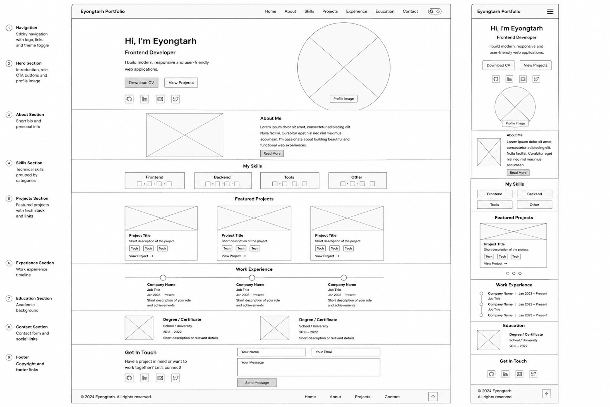

> _Figure: Low fidelity desktop and mobile wireframes from the planning phase._

<p align="right">(<a href="#top">Back to top ↑</a>)</p>

---

## Testing

### Automated Tests

The project has **119 automated tests** across 9 suites, written with **Jest** and **React Testing Library**. Run them with:

```bash
npm test
```

| Suite                    | What it checks                                                                                                            |
| ------------------------ | ------------------------------------------------------------------------------------------------------------------------- |
| `App.test.jsx`           | The whole page renders, the loading screen hands over to the content, lazy sections arrive, and there is exactly one `h1` |
| `LoadingScreen.test.jsx` | The loader shows, locks scrolling, fades and removes itself                                                               |
| `usePageReady.test.js`   | Minimum and maximum display times, and the page load event                                                                |
| `ConsentBanner.test.jsx` | Nothing loads from Google before consent, Decline works, the choice is remembered and can be changed                      |
| `ContactForm.test.jsx`   | Validation, focus on the first error, spam protection and friendly error messages                                         |
| `emailjs.test.js`        | Input limits, rate limiting, timeouts and error handling                                                                  |
| `ErrorHandling.test.jsx` | Error pages and section fallbacks, and that unsafe links such as `javascript:` are blocked                                |
| `data.test.js`           | Every skill icon meets 3:1 contrast, dates are valid and sorted, and every project link is safe                           |
| `dates.test.js`          | British English date formatting and year calculations                                                                     |

To check everything before pushing, run lint, tests and the production build together:

```bash
npm run check
```

### JavaScript Validation

JavaScript and JSX are checked with **ESLint**, including React's latest rules for hooks and component purity:

```bash
npm run lint
```

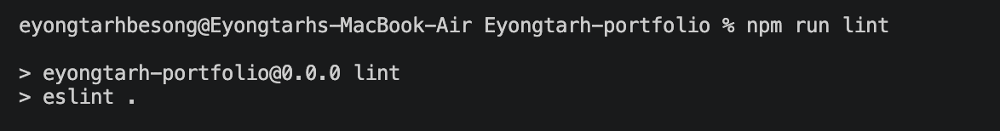

No errors are reported.

### Responsiveness

Responsiveness was checked throughout development with Chrome DevTools and the [Responsive Viewer](https://chrome.google.com/webstore/detail/responsive-viewer/inmopeiepgfljkpkidclfgbgbmfcennb) extension.

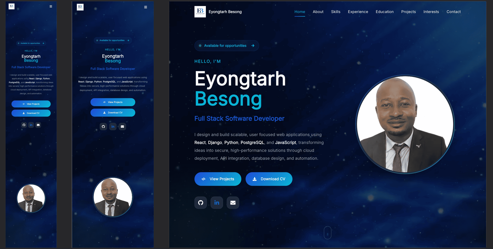

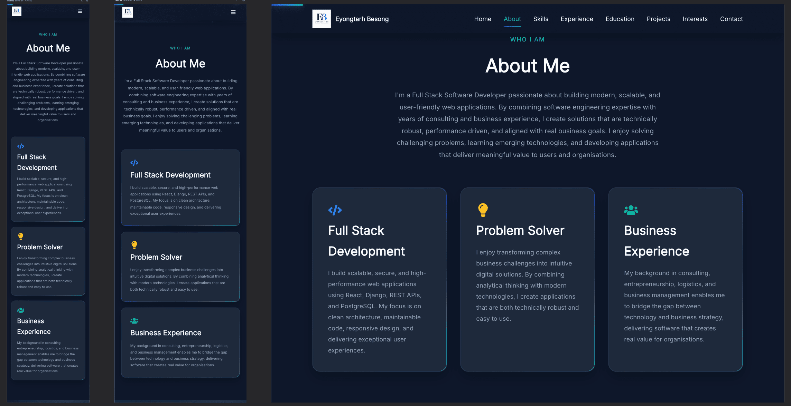

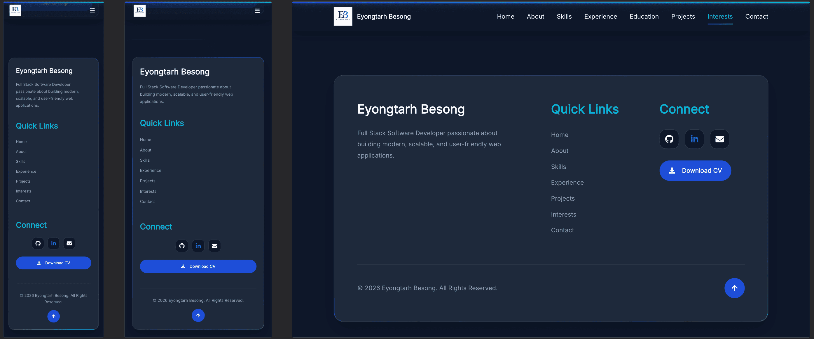

### Lighthouse Report

The portfolio was audited with **Google Lighthouse** for performance, accessibility, best practices and SEO.

- Desktop

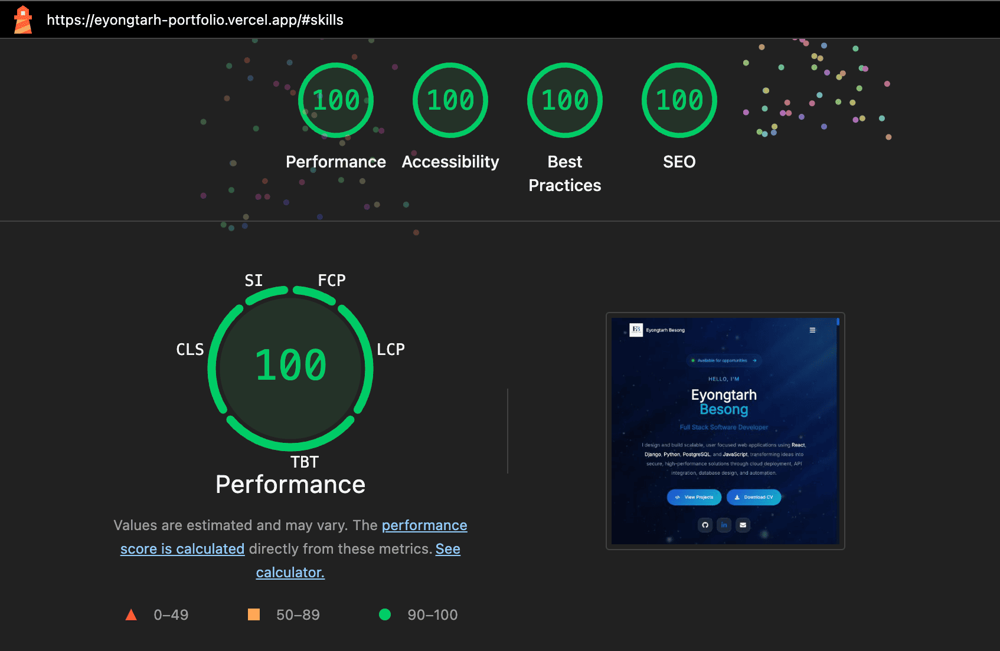

- Mobile

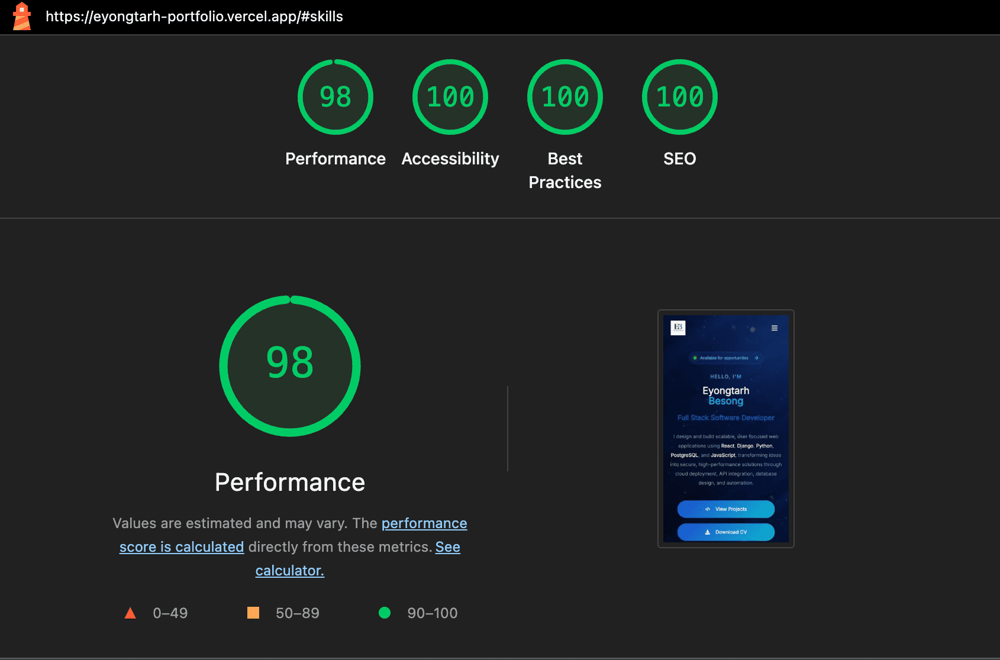

### Axe DevTools Accessibility Report

The portfolio was tested with **axe DevTools** to identify accessibility issues against WCAG.

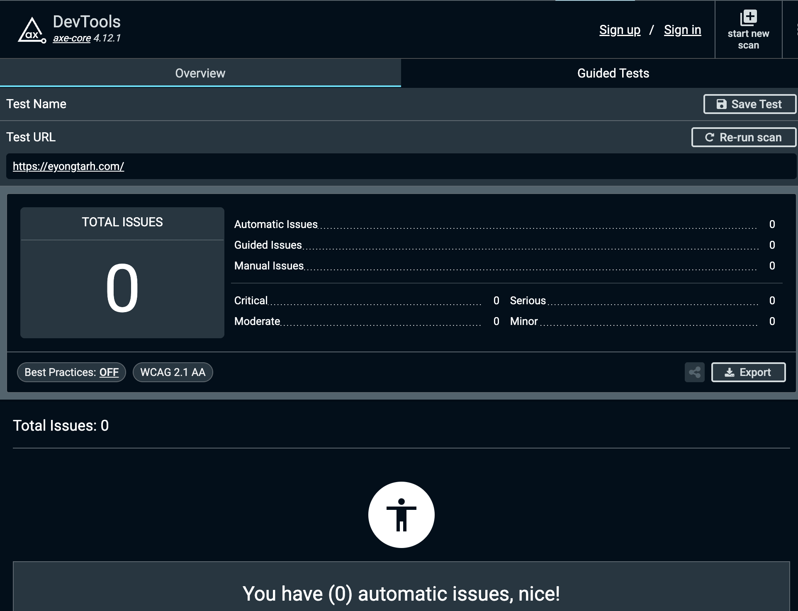

### CSS Validation

The [W3C CSS Validator](https://jigsaw.w3.org/css-validator/#validate_by_uri) reports errors for the modern masking properties used to draw the animated gradient borders on cards:

```css
-webkit-mask:
  linear-gradient(#fff 0 0) content-box,
  linear-gradient(#fff 0 0);
-webkit-mask-composite: xor;
mask:
  linear-gradient(#fff 0 0) content-box,
  linear-gradient(#fff 0 0);
mask-composite: exclude;
```

These properties are supported by all modern browsers (Chrome, Edge, Safari and Firefox) and render correctly. The validator simply doesn't recognise them yet, so the reported errors don't affect how the site works or looks.

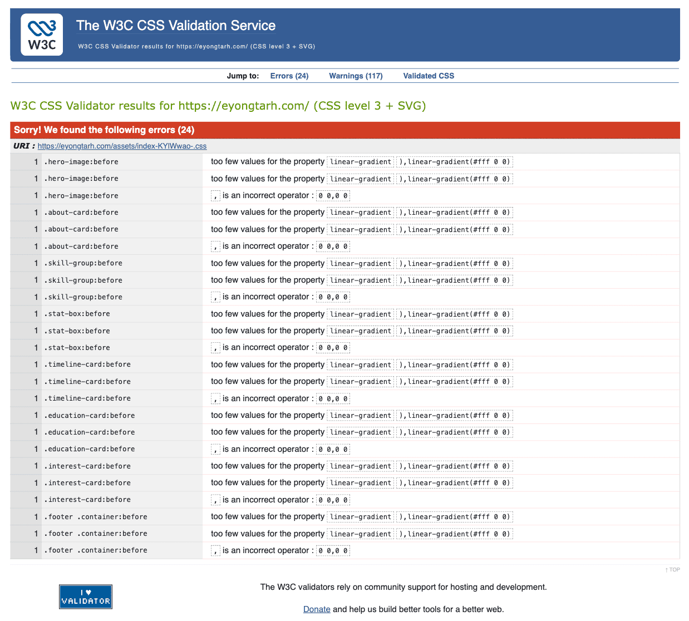

### HTML Validation

No errors or warnings were found with the official [W3C validator](https://validator.w3.org/), by pasting in the page source.

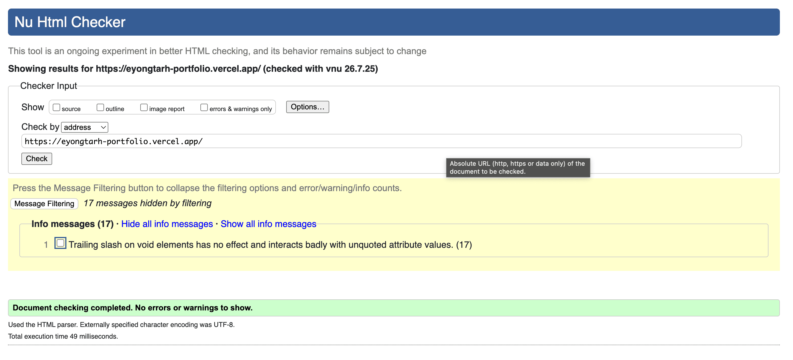

### Google Rich Results Test

The structured data (Person and WebSite) was tested with Google's [Rich Results Test](https://search.google.com/test/rich-results). The page was crawled successfully with no errors. Personal portfolios aren't eligible for rich results, so none are expected.

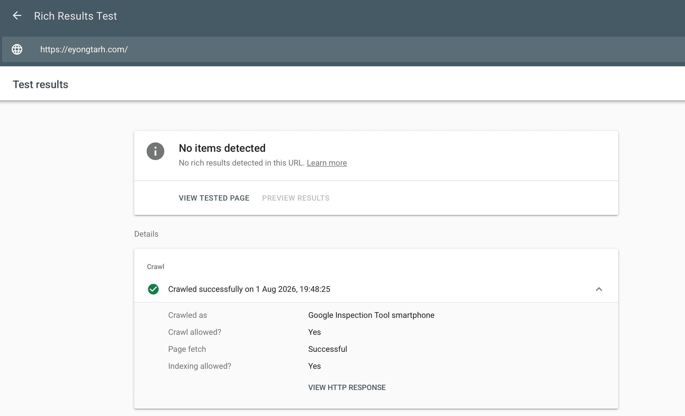

<p align="right">(<a href="#top">Back to top ↑</a>)</p>

---

## Security and Privacy

### Security Headers

`vercel.json` adds security headers to every response:

- **Content Security Policy**: only allows scripts, styles, images and connections from this site and the services it needs (EmailJS, Cloudinary and Google Analytics). No inline scripts are allowed.
- **Strict Transport Security**: browsers always use HTTPS.
- **X Content Type Options, X Frame Options and Cross Origin Opener Policy**: block content sniffing, framing by other sites and cross window attacks.
- **Referrer Policy and Permissions Policy**: limit what is shared with other sites and turn off camera, microphone, location and payment access.

### Contact Form Protection

- Every field is validated and length limited, both in the form and again before sending
- Control characters are stripped from input
- A hidden honeypot field and a minimum fill time catch most bots
- EmailJS blocks automated browsers and limits sending to one message every 30 seconds
- Requests time out after 15 seconds instead of hanging

### Privacy

Google Analytics is only loaded after a visitor presses **Accept**, in line with GDPR and the Swedish Electronic Communications Act. Until then nothing is downloaded from Google and no cookies are set. Decline is as easy as Accept, and **Cookie settings** in the footer lets visitors change their mind, which also removes existing analytics cookies.

<p align="right">(<a href="#top">Back to top ↑</a>)</p>

---

## Deployment

The portfolio is deployed on **Vercel**, with global delivery, automatic HTTPS and continuous deployment from GitHub.

### Continuous Deployment

Every push to the **main** branch triggers a production deployment. Vercel runs `npm run build`, which first refreshes the GitHub project data and the sitemap.

### First Time Setup on Vercel

1. Import the repository in Vercel. The **Vite** framework preset is detected automatically.
2. Add the environment variables from the [table above](#environment-variables) under **Settings**, **Environment Variables**.
3. Deploy. `vercel.json` applies the security headers automatically.

Variables starting with `VITE_` are built into the site, so after changing one, redeploy from the **Deployments** tab.

### Build Locally

```bash
npm run build
npm run preview
```

The production files are written to `dist/`. Note that `npm run preview` doesn't apply the headers in `vercel.json`; only Vercel does.

### Error Pages in Production

- **404**: Vercel serves `dist/404.html` with a real 404 status for unknown addresses. `vercel.json` must not contain a catch all rewrite, or this stops working.
- **Maintenance**: set `VITE_MAINTENANCE=true` in Vercel and redeploy.
- **After a redeploy**: visitors with the old version open are reloaded automatically when they need a file that no longer exists.

### Production

- **URL**: [https://eyongtarh.com](https://eyongtarh.com)
- Continuous deployment from GitHub
- Automatic HTTPS
- Node.js 22

<p align="right">(<a href="#top">Back to top ↑</a>)</p>

---

## Author

I'm a Full Stack Developer based in Gothenburg, building responsive web applications with React, Django, PostgreSQL and JavaScript. With a background in economics, consulting and business management, I enjoy creating software that combines clean engineering with practical business value.

---

## Contact

- **GitHub**: [Eyongtarh](https://github.com/Eyongtarh)
- **LinkedIn**: [A. Eyongtarh Besong](https://www.linkedin.com/in/a-eyongtarh-besong-22ab9b281/)
- **Email**: [eyongtarhb@gmail.com](mailto:eyongtarhb@gmail.com)

---

## Future Enhancements

- Add a blog section
- Add light and dark theme switching
- Integrate a CMS for managing projects
- Add multilingual support, starting with Swedish
- Run tests automatically on every pull request with GitHub Actions
- Serve all project images through Cloudinary

<p align="right">(<a href="#top">Back to top ↑</a>)</p>

---

## Credits

### Technologies

- **React**: user interface library
- **Vite**: build tool and development server
- **JavaScript**: application logic and interactivity
- **HTML5**: semantic page structure
- **CSS3**: styling, animations and responsive layouts
- **Framer Motion**: animations
- **React Icons**: scalable SVG icons
- **EmailJS**: email delivery for the contact form
- **Fontsource Variable (Inter)**: self hosted typography
- **QRCode Monkey**: QR code generation

### Development Tools

- **Visual Studio Code**: code editor
- **Git** and **GitHub**: version control and hosting
- **Vercel**: hosting and continuous deployment
- **Cloudinary**: image hosting and optimisation
- **Google Chrome DevTools**: debugging, testing and performance analysis

### Testing and Validation

- **Jest** and **React Testing Library**: automated tests
- **ESLint**: JavaScript and JSX validation
- **Google Lighthouse**: performance, accessibility, best practices and SEO audits
- **axe DevTools**: accessibility testing against WCAG
- **W3C HTML Validator** and **W3C CSS Validator**: markup and style validation
- **Google Rich Results Test**: structured data validation
- **Responsive Viewer**: responsiveness testing

### Design and Assets

- **Figma**: UI design and wireframes
- **favicon.io**: favicon generation
- **CompressPNG** and **IMGonline**: image compression and resizing

### Acknowledgements

Special thanks to the open source community for the libraries, tools and resources that made this project possible.

---

## Support

If you found this project helpful, consider giving the repository a ⭐ on GitHub.

---

## License

This project is licensed under the [MIT Licence](LICENSE).

---

Made with ❤️ using React, Vite and Framer Motion by **Eyongtarh Besong**.

<p align="right">(<a href="#top">Back to top ↑</a>)</p>
